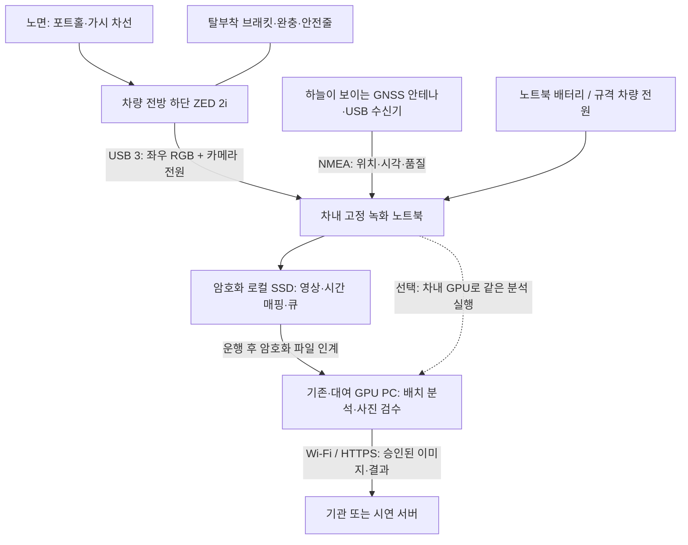
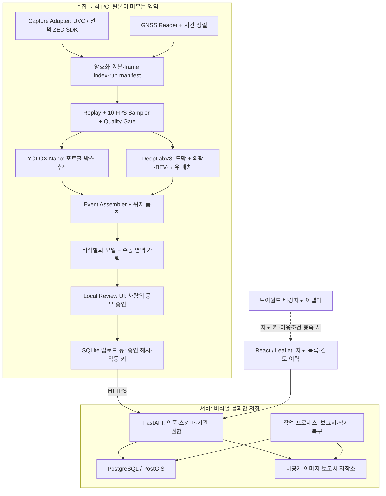
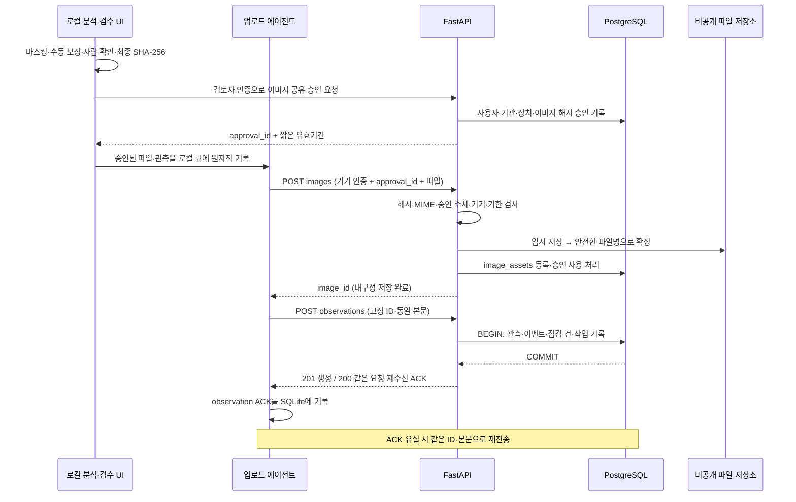
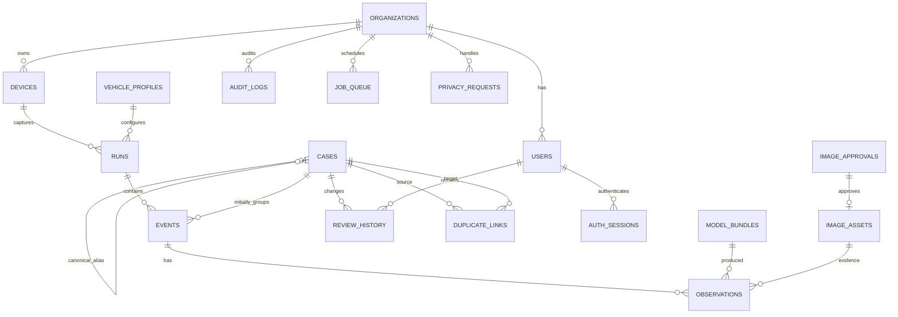
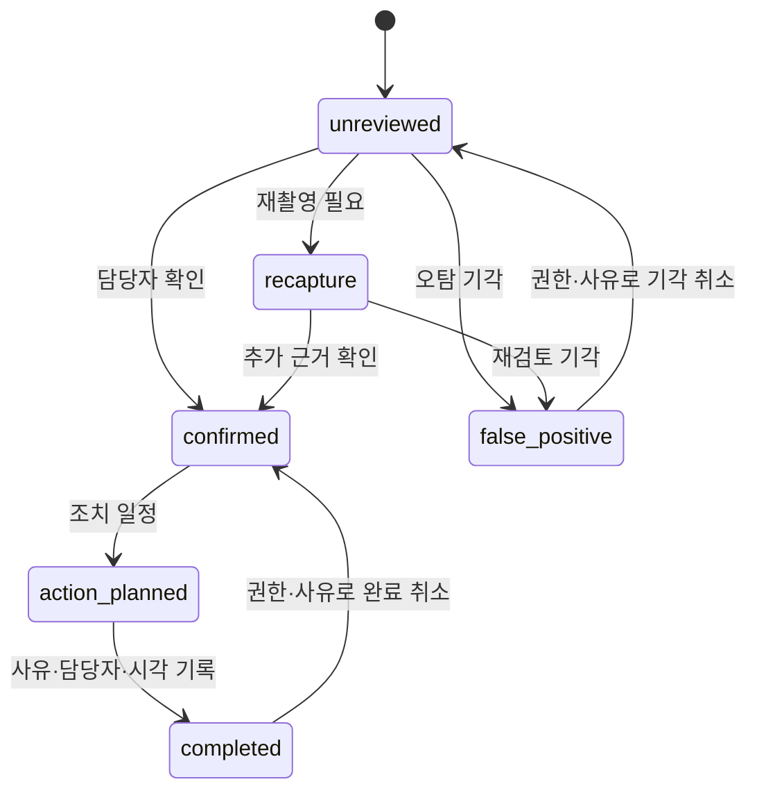

Here is the result of "fetch" for the Page with URL https://app.notion.com/p/40d8ac7c2dde81f3b7a4f3ae95edb804 as of 2026-11-03T09:37:56.644Z:
<page url="https://app.notion.com/p/40d8ac7c2dde81f3b7a4f3ae95edb804" icon="🏗️">
<ancestor-path>
<parent-page url="https://app.notion.com/p/40d8ac7c2dde801095cdca9e832444f8" title="글로벌공학설계프로젝트"/>
</ancestor-path>
<properties>
{"title":"시스템 설계서 (SDD)"}
</properties>
<iconMetadata>{"type":"emoji","emoji":"🏗️"}</iconMetadata>
<content>
<callout icon="🏗️" color="blue_bg">
문서: 시스템 설계서(SDD) v1.0 · 작성일: <date start="2026-11-03" /><br />기준 문서: 기획서/제안서 v0.4와 SRS v0.4. <b>ZED 2i 유지·포트홀/마모차선 인식·B2G·4명/8주</b> 조건을 따른다.<br />이 문서는 구현을 위한 설계 기준이며 장비 조립·소프트웨어 구현·성능시험·실제 배포 완료를 뜻하지 않는다.
</callout>

<table-of-contents />

# 1. 설계 범위와 기준

참조: <mention url="https://app.notion.com/p/40d8ac7c2dde815b87b4e35b991407dc" />, <mention url="https://app.notion.com/p/40d8ac7c2dde818c91dff83bae17dcbf" />.

필수 운용 범위는 주간·건조 아스팔트·20 km/h 이하·백색/황색 실선/점선이다. 차량에서 좌우 영상을 녹화한 뒤 GPU PC에서 분석하고, 담당자가 사진을 검토해 점검 건을 관리한다. 차량 내 실시간 분석은 권장 기능이며 스테레오 깊이 보조 확인은 후속 기능이다. 도색·자동 보수·차량 제어·포트홀 치수/부피·법정 재귀반사검사 대체 기능은 넣지 않는다.

기획서의 추가 예산 제안 한도 800,000원·계획액 736,000원과 기존/대여 PC 사용을 유지한다. 설계용 성능 기준은 RTX 3060 12 GB·RAM 16 GB급이며 실제 보유 사양으로 단정하지 않는다. 구체 패키지 패치 버전과 장치 드라이버는 W1 호환 시험 후 잠금 파일로 고정한다.

| 설계 ID | 결정 | 이유 |
| --- | --- | --- |
| ADR-01 | 배치 처리 필수, 같은 분석 모듈로 실시간 모드 확장 | 차량 내 고가 계산 장치·LTE 구매 의존성 완화 |
| ADR-02 | 취득 30 FPS/눈당 720p, 분석 입력 10 FPS | 수집 누락 검증과 분석 성능을 분리 |
| ADR-03 | FastAPI 모듈형 서버 1개 + 별도 작업 프로세스 | 8주 개발에서 서비스 간 운영 부담을 줄이고 내구성 작업을 분리 |
| ADR-04 | PostgreSQL 16 + PostGIS, 이미지 파일은 비공개 저장소 | 관계·공간 조회·이력의 일관성 확보 |
| ADR-05 | UUID 관측 ID + 불변 요청 해시 + DB 트랜잭션 ACK | 통신 단절·중복 수신에도 이중 생성 방지 |
| ADR-06 | 관측·주행 이벤트·점검 건(case)을 구분 | 같은 영상의 반복 탐지와 반복 주행·실제 관리 이력을 구분 |
| ADR-07 | 기기 전송 권한과 사람의 사진 공유 승인 분리 | 클라이언트의 redacted=true 선언만으로 공유를 승인하지 않음 |
| ADR-08 | 공간 근접은 중복 후보만 생성 | GNSS 오차로 가까운 다른 포트홀을 자동 합치지 않음 |

# 2. 하드웨어 구성

## 2.1 하드웨어 구성도



<table header-row="true">
<colgroup>
<col width="180" />
<col width="400" />
<col width="600" />
</colgroup>
<tr>
<td>
구성
</td>
<td>
연결·요구 조건
</td>
<td>
설치·확인 항목
</td>
</tr>
<tr>
<td>
ZED 2i
</td>
<td>
USB 3 데이터/전원, 좌우 RGB
</td>
<td>
카메라 일련번호·실제 렌즈·USB 경로·취득 해상도/FPS 기록. 허브 사용 시 실측 대역폭·전원 확인
</td>
</tr>
<tr>
<td>
거치부
</td>
<td>
전방 범퍼 하단, 초기 높이 0.6\~0.9 m, 하향 20°·±10° 조절
</td>
<td>
기존 체결점·차종별 탈부착 구조, 이중 고정·안전줄. 번호판·등화·센서·흡기·최저지상고 간섭 금지
</td>
</tr>
<tr>
<td>
GNSS
</td>
<td>
5 Hz 설정 가능 NMEA USB 수신기, 외장 안테나
</td>
<td>
하늘 가림 최소화. 원래 주행 시각·수신 UTC·fix·HDOP 기록. RTK 필수 아님
</td>
</tr>
<tr>
<td>
녹화 노트북·SSD
</td>
<td>
눈당 1280×720/30 FPS, 암호화 저장
</td>
<td>
수집 UI는 정차 조작. 케이블 인장 완화, 차내 고정, 60분 취득 시험
</td>
</tr>
<tr>
<td>
분석 PC
</td>
<td>
GPU 기준 RTX 3060 12 GB·RAM 16 GB급
</td>
<td>
포트홀·차선·비식별화 전체 10 FPS 시험. 녹화 노트북과 동일 장치여도 됨
</td>
</tr>
<tr>
<td>
전원·통신
</td>
<td>
노트북 정격 전원, USB 카메라, 운행 후 Wi-Fi
</td>
<td>
차량 규격·부하에 맞는 보호 전원. LTE·인버터 특정 제품을 필수로 지정하지 않음
</td>
</tr>
</table>

## 2.2 시야·장착 프로파일

광학 중심 높이·하향 각도는 초기값이며 차종·렌즈별로 재보정한다. 목표 가시 노면은 약 1.5\~6 m, 그중 연속 종방향 3 m 이상이다. 설치 높이/각도만으로 시야를 보증하지 않고 실차 격자 영상으로 확인한다. 보이는 차선만 점검하며 중앙 차체 바닥에 가려진 설치 위치는 사용하지 않는다.

프로파일에는 vehicle\_label, camera\_serial, lens\_label, 좌우 해상도, 높이·각도, 렌즈 보정행렬, 왜곡계수, 노면 homography, ROI 폴리곤, 유효 거리 범위, 보정 날짜·검수자·파일 해시를 저장한다. 각도/렌즈/거치 위치 변경 시 새 버전을 발급한다. 고속·급격한 경사·심한 진동으로 평면 가정이 깨지면 잔존율 판정을 보류한다.

제조사의 UVC 좌우 결합 영상 취득 경로를 기본으로 사용하고 깊이·SVO 선택 경로만 ZED SDK 어댑터로 분리한다. SDK 기능에는 별도의 NVIDIA/CUDA 요구가 있다. [Stereolabs 공식 안내](https://support.stereolabs.com/articles/7166665108-can-i-use-the-zed-without-cuda)

## 2.3 운행 전·후 확인

운행 전 고정·안전줄·배선·렌즈·전원·저장 10 GB 이상·영상 프리뷰·GNSS·프로파일을 점검하고 run manifest에 결과를 저장한다. 한 항목이라도 필수 조건이 틀리면 촬영을 시작하지 않는다. 운행 후 이탈·오염·파일 무결성을 확인한다. 결함 발견 시 마지막 정상 확인 이후 구간을 검토 대상으로 표시하고 정상 점검 범위에 합산하지 않는다. 본체 IP66을 장치 전체의 방수·충격 인증으로 표시하지 않는다.

# 3. 소프트웨어 아키텍처

## 3.1 논리 구성도



<table header-row="true">
<colgroup>
<col width="220" />
<col width="410" />
<col width="560" />
</colgroup>
<tr>
<td>
모듈
</td>
<td>
입력 → 출력
</td>
<td>
책임·장애 처리
</td>
</tr>
<tr>
<td>
Capture/GNSS
</td>
<td>
좌우 프레임·NMEA → 영상 조각·시각 로그
</td>
<td>
5분 단위 MP4 분할, 임시 파일 완결 후 rename·해시. 기록 중 장애의 손상 범위를 제한
</td>
</tr>
<tr>
<td>
Replay/Quality
</td>
<td>
영상·프로파일 → 10 FPS 샘플·품질 사유
</td>
<td>
원본 frame\_id·PTS 보존, 시간 점프 감지. 품질 미달도 계수해 평가에서 숨기지 않음
</td>
</tr>
<tr>
<td>
Pothole Detector/Tracker
</td>
<td>
좌영상 → 박스·confidence·track
</td>
<td>
416×416 letterbox와 역변환. IoU 시간 연계·이벤트 집계
</td>
</tr>
<tr>
<td>
Lane Analyzer
</td>
<td>
좌영상·보정 → 도막·외곽·잔존율/불가
</td>
<td>
긴 변 512 입력, 원영상/BEV 역매핑, 점선 공백 제외·패치 중복 제거
</td>
</tr>
<tr>
<td>
Redaction/Local Review
</td>
<td>
대표 사진 → 마스킹 사진·승인 증명
</td>
<td>
얼굴/번호판 별도 YOLOX-Nano, 수동 사각 가림. 승인 뒤 파일 변경 시 승인 폐기
</td>
</tr>
<tr>
<td>
Upload Agent
</td>
<td>
승인된 사진·JSON → 서버 ACK
</td>
<td>
SQLite 트랜잭션 큐, 재전송·영구 오류 구분. 원본 저장 경로는 업로더 허용 목록에 없음
</td>
</tr>
<tr>
<td>
API/Domain
</td>
<td>
인증 요청 → 관측·case·검토 이력
</td>
<td>
기관 격리·멱등 수신·버전 비교·상태 전이
</td>
</tr>
<tr>
<td>
Report/Retention Worker
</td>
<td>
DB 작업 행 → CSV/PDF·삭제 기록
</td>
<td>
재시작 가능한 DB 작업 큐, lease 만료 시 재수행. 장기 작업을 요청 프로세스 메모리에만 두지 않음
</td>
</tr>
</table>

## 3.2 실행·동시성

수집 프로세스와 GPU 분석 프로세스를 분리한다. 기본 배치 모드는 수집 완료 파일을 순차 처리하므로 분석 지연이 촬영 중 프레임 손실로 전파되지 않는다. 실시간 모드는 크기가 제한된 프레임 큐를 사용하고 분석 프레임 생략 수를 기록하되, 원본 녹화 큐와 분리한다.

서버는 인증·장치/기관·관측·점검/검토·이미지·보고서·개인정보 모듈을 둔 단일 애플리케이션으로 시작한다. 별도 worker 1개가 PostgreSQL 작업 행을 잠금/lease로 가져간다. 초기에는 Redis·Kafka·Kubernetes를 필수로 도입하지 않는다. 요청 종료 후 실행되는 메모리 작업만으로 보고서·삭제의 내구성을 보장하지 않는다. [FastAPI Background Tasks 공식 문서](https://fastapi.tiangolo.com/tutorial/background-tasks/)

# 4. 분석·동기화 상세 설계

## 4.1 시각·위치 정렬

프레임마다 run\_id, frame\_id, PTS, 로컬 단조시계, 보정 UTC를 기록한다. GNSS 문장에는 장치 UTC와 PC 수신 시각을 함께 남긴다. 시스템 시각 보정량·점프를 기록하고 미래/역행 프레임은 별도 경고한다. 하드웨어 동기화로 오인하지 않는다.

같은 연속 구간의 유효 fix 중 보정 UTC가 가장 가까운 표본을 연결한다. 양쪽 유효 표본 간격이 2초 이하일 때만 보간할 수 있고, 2초 초과·무효 fix·HDOP > 3은 degraded/unavailable로 둔다. 시각 차이 P95 0.5초 이하를 시험한다. 위치가 없으면 좌표·accuracy\_m은 null이며 HDOP를 미터 단위 정확도로 바꾸지 않는다. 모든 좌표는 WGS84, 서버 저장 UTC·화면 Asia/Seoul이다.

차량 관측점은 객체의 실제 위치와 다르다. 지도·보고서에 이 출처를 표시하며 깊이 기반 객체 좌표 보정은 선택 어댑터로만 둔다. 저속 GNSS 위치 흔들림을 차선 길이로 적분하지 않도록, fix 유효성·정지 임계·속도와 영상 노면 이동의 일관성을 점검한다. 거리 품질이 부족하면 “약 10 m” 구간을 강제로 만들지 않고 프레임 묶음·길이 null로 남긴다.

## 4.2 포트홀 이벤트

YOLOX-Nano 초기 confidence=0.35, NMS IoU=0.5로 시작한다. 좌영상 원본 픽셀 기준 xywh 박스를 보존하고 confidence·입력 크기·변환값을 기록한다. 같은 track의 1초 이내 3회 이상 관측을 기본 이벤트로 채택한다. 1\~2회만 보인 confidence ≥ 0.8 후보는 single\_frame\_review로 남긴다. 가림/물로 의미가 불확실하면 held로 분리한다.

대표 사진은 유효 ROI 안의 선명도·크기·품질 점수로 선정하고 원래 frame\_id와 연결한다. 초기 추적은 시간·IoU로 구현하며 최종 임계값은 검증셋에서 W6 동결한다. 물리적 깊이·부피·위험 확률을 박스 크기나 confidence에서 생성하지 않는다.

## 4.3 차선 외곽·BEV·패치

1. 남은 도막 분할 → 렌즈 왜곡 보정 → 노면 homography로 BEV 변환한다.
2. 보이는 경계·진행 방향·인접 프레임 단서를 이용해 예상 도색 외곽을 구성한다. 점선의 설계상 빈 구간은 분모에서 제외한다.
3. BEV에서 동일 차선의 고유 노면 패치를 연결한다. run·lane track·상대 누적 거리 범위·겹침으로 재관측을 묶고 같은 패치를 여러 번 면적 합산하지 않는다.
4. 외곽 면적 중 유효한 면적 비율이 70% 이상인 패치만 R=남은 도막 면적/유효 예상 도색 면적×100을 계산한다. 외곽 근거 자체가 없으면 R=null이다.
5. 약 10 m 구간에서 중복 제거한 유효 패치 면적 가중 평균을 구한다. 예상 구간의 80% 이상에 외곽/유효 근거가 있을 때만 등급을 내고 나머지는 unassessable이다.

R ≥ 80은 visible\_good, 60 ≤ R \< 80은 monitor, R \< 60은 worn\_candidate다. 전부 사라진 차선·원래 차선이 없는 곳을 임의의 외곽으로 복원해 마모율을 계산하지 않는다. 임계값은 내부 설계값이며 법정 반사성능 기준이 아니다. patch별 마스크·외곽·단서·면적·매칭 근거를 로컬 분석 산출물로 남기고 서버에는 검수용 비식별 오버레이와 요약값만 보낸다.

## 4.4 모델·설정 버전

model\_bundle은 포트홀·도막·비식별화 가중치의 SHA-256, 코드 커밋, 환경 잠금 해시, 입력 정규화/resize, confidence/NMS, 차선 임계값·품질 기준을 하나로 묶는다. 설치 프로파일과 모델 번들은 불변 버전으로 관리한다. 같은 observation\_id에 다른 버전 결과를 덮어쓰지 않으며 재분석은 새 관측 ID와 재분석 출처를 만든다.

# 5. 데이터 흐름과 재전송

## 5.1 업로드·검수 시퀀스



공유 승인은 서버에 원본을 먼저 보내는 절차가 아니다. 로컬 검수자가 비식별 최종 파일을 확인한 후 해시·크기·촬영 시각만 승인 요청한다. 서버는 로그인된 검토자의 권한과 승인 해시를 확인한다. 서명/승인 정보는 “승인자가 이 파일을 확인했다”는 증거이며 픽셀에 개인정보가 없음을 자동 증명하는 것으로 취급하지 않는다.

이미지 업로드는 최종 파일 해시와 승인 해시가 같아야 한다. 재압축·오버레이·영역 가림을 추가하면 재승인이 필요하다. 기기 토큰만으로 승인 생성·검토 상태 변경을 할 수 없다.

## 5.2 로컬 큐 상태

| 상태 | 진입·다음 상태 | 보존·복구 |
| --- | --- | --- |
| pending | 로컬 분석·검수 완료 → uploading | observation\_id·고정 JSON·파일 해시·승인 ID·시도 횟수 저장 |
| uploading | 이미지 확인 → 관측 전송 → acked | 프로세스 재시작 시 lease 만료 건을 pending으로 복구 |
| acked | 서버 관측 COMMIT ACK 확인 | 재전송 불필요. 로컬 보관 정책에 따라 정리 |
| blocked | 401/403·승인 만료·409 충돌·422 | 사유 표시, 재인증/재승인/명시적 수정 전 자동 반복 금지 |
| expired | 촬영 후 90일 경과·삭제 요청 대상 | 서버 재생성 금지, 로컬 정책에 따라 삭제 |

5초→15초→60초→이후 5분 간격 재시도는 네트워크 오류·408·5xx에 적용한다. 429는 Retry-After를 우선한다. 동일 ID·동일 본문은 같은 결과를 반환하고, 동일 ID·다른 해시는 409다. 수정한 관측은 새 ID로 만들고 이전 ID를 재사용하지 않는다. 전송 성공과 멱등 키 등록은 같은 DB 트랜잭션에 포함한다. [PostgreSQL ON CONFLICT](https://www.postgresql.org/docs/16/sql-insert.html)

이미지 파일과 DB는 분산 원자 트랜잭션이 아니므로 staging·해시·상태를 둔다. 임시 파일 잔여는 정리 작업이 지우고, image\_assets가 ready인 파일만 관측에 연결한다. 참조 없는 파일은 24시간 또는 촬영 후 90일 중 빠른 시점에 삭제한다. 서버 ACK는 파일 확정/DB COMMIT 이후에만 반환한다.

# 6. DB 개념 설계

## 6.1 식별자와 업무 단위

- <b>run\_id:</b> 한 번의 촬영 주행. 기기·설치 프로파일·시각·가시 범위를 연결한다.
- <b>event\_id:</b> 같은 주행에서 추적으로 묶인 포트홀 또는 차선 구간 후보. 반복 주행의 다른 event와 같다고 가정하지 않는다.
- <b>observation\_id:</b> 대표 프레임·모델 결과·사진의 불변 관측. 한 event에 여러 관측이 있을 수 있다. 멱등 수신 기준이다.
- <b>case\_id:</b> 담당자가 검토·조치하는 점검 건. 첫 event 수신 시 생성하고, 반복 주행의 같은 대상으로 확인된 경우에만 수동으로 같은 대표 case에 연결한다.

case는 SRS의 검토/조치 이력을 안정적으로 관리하기 위한 내부 테이블이며 새로운 탐지 기능을 추가하는 것이 아니다. 기존 observation 기반 API는 연결된 대표 case의 검토 상태를 반환한다. 관측 수·주행 이벤트 수·중복 확인 후 점검 건 수를 구분해 집계한다.

## 6.2 ERD

모든 기관 소유 테이블은 org\_id를 갖고 관계는 같은 기관 안에서만 연결한다. 아래 그림은 업무 관계이며 기관 격리용 복합키는 테이블 사전에 추가로 정의한다.



## 6.3 표기·공통 규칙

PK/FK는 UUID, 시각은 timestamptz, 수치에는 NaN/Infinity를 허용하지 않는다. NN은 NOT NULL, UQ는 UNIQUE다. org\_id는 인증 문맥에서 정하며 요청 본문으로 바꿀 수 없다. 기관 소유 테이블은 (org\_id,id) UQ를 만들고 FK도 (org\_id,참조\_id)로 연결한다. 기관을 생략한 UUID 단독 참조만으로 교차 기관 입력을 허용하지 않는다.

원본 영상·SVO·원시 NMEA는 서버 DB·이미지 저장소에 저장하지 않는다. 표의 jsonb 필드도 허용 키·크기·스키마를 검증한다. 요청 전체·토큰·원본 경로를 감사로그에 기록하지 않는다.

# 7. DB 논리 설계·제약

## 7.1 테이블 사전

<table header-row="true">
<colgroup>
<col width="200" />
<col width="650" />
<col width="610" />
</colgroup>
<tr>
<td>
테이블
</td>
<td>
주요 컬럼·형식
</td>
<td>
키·제약/역할
</td>
</tr>
<tr>
<td>
organizations
</td>
<td>
id uuid PK; code varchar(64) NN UQ; name varchar(120) NN; active boolean NN; retention\_policy jsonb NN; created\_at timestamptz
</td>
<td>
기관별 보관 정책, 기본값은 SRS 기준. 정책 변경 감사 기록
</td>
</tr>
<tr>
<td>
users
</td>
<td>
id uuid PK; org\_id uuid NN; login varchar(254) NN; password\_hash text NN; role varchar(16) NN; active boolean NN
</td>
<td>
UQ(org\_id,login), role=admin/reviewer/viewer. 수집자는 검수 권한이 있는 계정을 별도로 사용
</td>
</tr>
<tr>
<td>
auth\_sessions
</td>
<td>
id uuid PK; org\_id,user\_id uuid NN; token\_hash text NN; expires\_at,revoked\_at timestamptz
</td>
<td>
원문 토큰 저장 금지. 서버 세션으로 즉시 만료·취소 가능
</td>
</tr>
<tr>
<td>
devices
</td>
<td>
id uuid PK; org\_id uuid NN; name varchar(100); credential\_hash text NN; active boolean; last\_seen\_at timestamptz
</td>
<td>
device 토큰은 해당 기관·기기의 run/이미지/관측 전송만 허용. 비활성화 즉시 차단
</td>
</tr>
<tr>
<td>
vehicle\_profiles
</td>
<td>
id uuid PK; org\_id uuid NN; name varchar(100); version integer NN; camera\_serial/lens\_label text; calibration jsonb NN; config\_hash char(64) NN
</td>
<td>
UQ(org\_id,name,version). 높이·각도·ROI·보정·해상도 포함, 사용 후 수정 금지
</td>
</tr>
<tr>
<td>
model\_bundles
</td>
<td>
id uuid PK; org\_id uuid NN; version text NN; weights\_hashes,preprocess,thresholds jsonb NN; config\_hash char(64) NN
</td>
<td>
UQ(org\_id,version). 포트홀/차선/마스킹 해시·코드·환경 잠금
</td>
</tr>
<tr>
<td>
runs
</td>
<td>
id uuid PK; org\_id,device\_id,profile\_id uuid NN; started\_at timestamptz NN; ended\_at timestamptz; status text; manifest\_hash char(64); path\_geom geometry(MultiLineString,4326); path\_quality text; path\_segments jsonb; expires\_at timestamptz
</td>
<td>
기기·프로파일 기관 일치. 실제 종료 ≥ 시작. raw NMEA 대신 허용한 요약 경로만 저장, 경로 품질 저하 시 선 연결 중단
</td>
</tr>
<tr>
<td>
cases
</td>
<td>
id uuid PK; org\_id uuid NN; type text NN; status text NN; priority text NN; version integer NN; merged\_into uuid null; representative\_observation\_id uuid null; first\_seen\_at,last\_seen\_at,completed\_at timestamptz; reason text
</td>
<td>
type=pothole/lane\_segment. 상태 8장 규칙, version≥1. 자기 병합·순환 금지. 대표 관측 만료 시 재선정/비움
</td>
</tr>
<tr>
<td>
events
</td>
<td>
id uuid PK; org\_id,run\_id,case\_id uuid NN; type text NN; track\_key text NN; first\_at,last\_at timestamptz NN
</td>
<td>
UQ(org\_id,run\_id,track\_key). 기기의 고정 event\_id 보존. type은 case·관측과 같음
</td>
</tr>
<tr>
<td>
image\_approvals
</td>
<td>
id uuid PK; org\_id,device\_id,reviewer\_id,file\_id uuid NN; sha256 char(64) NN; captured\_at,approved\_at,expires\_at timestamptz NN; used\_at timestamptz
</td>
<td>
서버 검토자 인증으로 생성, hash·file\_id·기기·기관에 바인딩. 최초 사용 유효기간 15분
</td>
</tr>
<tr>
<td>
image\_assets
</td>
<td>
id uuid PK; org\_id,device\_id,approval\_id uuid NN; sha256 char(64) NN; mime text NN; size\_bytes integer NN; object\_key text NN; captured\_at,expires\_at timestamptz NN; state text NN
</td>
<td>
id는 file\_id와 동일. UQ(org\_id,id), UQ(org\_id,approval\_id). ready/deleting. 동일 ID의 다른 해시 409. SHA 해시만으로 다른 관측/다른 시각 파일을 무조건 합치지 않음
</td>
</tr>
<tr>
<td>
observations
</td>
<td>
id uuid PK; org\_id,event\_id,image\_id,model\_bundle\_id uuid NN; captured\_at timestamptz NN; frame\_id bigint NN; schema\_version text NN; request\_hash char(64) NN; payload jsonb NN; position geography(Point,4326); location\_quality text NN; expires\_at timestamptz NN
</td>
<td>
공통·종류별 상세 7.2절. 기기/run/profile은 event→run FK로 유도, API 입력과 일치 검사. 관측은 삽입 후 불변
</td>
</tr>
<tr>
<td>
duplicate\_links
</td>
<td>
id uuid PK; org\_id,source\_case\_id,target\_case\_id uuid NN; status text NN; distance\_m real; evidence jsonb; decided\_by uuid; reason text; version integer NN
</td>
<td>
UQ(org\_id,source\_case\_id,target\_case\_id), 같은 type·서로 다른 case. suggested/approved/rejected/revoked
</td>
</tr>
<tr>
<td>
review\_history
</td>
<td>
id uuid PK; org\_id,case\_id,actor\_id uuid NN; from\_status,to\_status text; from\_priority,to\_priority text; reason varchar(500) NN; case\_version integer NN; context jsonb; at,expires\_at timestamptz NN
</td>
<td>
변경과 같은 트랜잭션 append. 상태·우선순위·병합/취소 이력. 업무 상세는 90일 정책으로 삭제
</td>
</tr>
<tr>
<td>
audit\_logs
</td>
<td>
id uuid PK; org\_id uuid NN; actor\_kind text; actor\_ref\_hash text; action text; target\_ref\_hash text; result text; at,expires\_at timestamptz
</td>
<td>
180일, 이미지·좌표·JWT·비밀번호·자유서술 개인정보 제외. 업무 상세 삭제 후에도 최소 행위 기록만 남김
</td>
</tr>
<tr>
<td>
job\_queue
</td>
<td>
id uuid PK; org\_id uuid NN; kind text NN; payload jsonb NN; state text NN; attempts integer; next\_at,lease\_until timestamptz; result\_key text; error\_code text; dedup\_key char(64); expires\_at timestamptz
</td>
<td>
report/retention/privacy-delete, pending/running/succeeded/failed. UQ(org\_id,dedup\_key), 일반 작업은 dedup\_key nullable. 결과 파일은 원자료보다 오래 보관하지 않음
</td>
</tr>
<tr>
<td>
privacy\_requests
</td>
<td>
id uuid PK; org\_id uuid NN; type text; status text; target\_refs jsonb; assignee\_id uuid; created\_at,resolved\_at,expires\_at timestamptz
</td>
<td>
열람/정정/삭제 요청의 최소 연결정보. 민감한 요청자 정보는 일반 로그에 넣지 않고 요청 종료 후 목적에 맞게 정리
</td>
</tr>
</table>

## 7.2 관측 상세와 공간 데이터

observations.payload는 SRS v0.4 JSON을 보존하고 query용 주요 필드는 같은 트랜잭션에서 정규 컬럼으로 투영한다. 추가 컬럼: type text NN, confidence real nullable, retention\_pct real nullable, lane\_grade text nullable, valid\_area\_ratio real nullable, outline\_supported boolean nullable, unassessable\_reason text nullable, quality\_reasons jsonb NN. 도막/외곽 마스크와 박스의 원본 좌표계·frame 크기는 payload에 보존한다.

포트홀 상세에는 bbox\_xywh\_px, confidence, track\_observations, candidate\_state(multi\_frame/single\_frame\_review/held), occluded가 있다. 차선 상세에는 segment\_id UUID, estimated\_length\_m nullable, retention\_pct nullable, grade, color(white/yellow/unknown), line\_type(solid/dashed/unknown), valid\_area\_ratio, outline\_supported, patch\_ids, unassessable\_reason이 있다. JSON의 반대 종류 필드는 null이어야 한다.

position은 관측 시점 차량 좌표다. 생성 순서는 ST\_MakePoint(lon,lat)이며 geography의 ST\_DWithin(...,10)은 10 m 후보 탐색에 사용한다. geometry(4326)의 10을 10 m로 해석하지 않는다. 거리 검색에는 GiST 인덱스를 둔다. [PostGIS 거리 문서](https://postgis.net/docs/ST_DWithin.html), [점 생성 문서](https://postgis.net/docs/ST_MakePoint.html)

## 7.3 핵심 제약·인덱스 SQL

아래는 테이블 사전에 적용할 핵심 DDL 예시다. 전체 생성/삭제 순서·이관·권한은 Alembic 마이그레이션에서 함께 작성하며, 실제 DB에서 실행·검증한 마이그레이션 파일로 표시하지 않는다.

```sql
CREATE EXTENSION IF NOT EXISTS postgis;

-- 모든 기관 소유 테이블에 같은 패턴을 적용한다.
ALTER TABLE events ADD CONSTRAINT events_org_id_uq UNIQUE (org_id, id);
ALTER TABLE image_assets ADD CONSTRAINT images_org_id_uq UNIQUE (org_id, id);
ALTER TABLE observations
  ADD CONSTRAINT obs_event_same_org
  FOREIGN KEY (org_id, event_id) REFERENCES events(org_id, id);
ALTER TABLE observations
  ADD CONSTRAINT obs_image_same_org
  FOREIGN KEY (org_id, image_id) REFERENCES image_assets(org_id, id);
ALTER TABLE observations
  ADD CONSTRAINT obs_type_ck CHECK (type IN ('pothole','lane_segment')),
  ADD CONSTRAINT obs_payload_ck CHECK (jsonb_typeof(payload) = 'object'),
  ADD CONSTRAINT obs_frame_ck CHECK (frame_id >= 0),
  ADD CONSTRAINT obs_conf_ck CHECK
    (confidence IS NULL OR (confidence >= 0 AND confidence <= 1)),
  ADD CONSTRAINT obs_valid_ck CHECK
    (valid_area_ratio IS NULL OR
     (valid_area_ratio >= 0 AND valid_area_ratio <= 1)),
  ADD CONSTRAINT obs_retention_ck CHECK
    (retention_pct IS NULL OR (retention_pct >= 0 AND retention_pct <= 100)),
  ADD CONSTRAINT obs_kind_ck CHECK (
    (type = 'pothole' AND confidence IS NOT NULL
      AND retention_pct IS NULL AND lane_grade IS NULL)
    OR
    (type = 'lane_segment' AND confidence IS NULL
      AND lane_grade IS NOT NULL
      AND lane_grade IN ('visible_good','monitor','worn_candidate','unassessable')
      AND outline_supported IS NOT NULL
      AND (
        (lane_grade = 'unassessable' AND retention_pct IS NULL
          AND unassessable_reason IS NOT NULL)
        OR
        (lane_grade <> 'unassessable' AND retention_pct IS NOT NULL
          AND valid_area_ratio IS NOT NULL
          AND valid_area_ratio >= 0.70 AND outline_supported = true
          AND ((retention_pct >= 80 AND lane_grade = 'visible_good')
            OR (retention_pct >= 60 AND retention_pct < 80 AND lane_grade = 'monitor')
            OR (retention_pct < 60 AND lane_grade = 'worn_candidate')))
      ))
  );

CREATE INDEX obs_org_time_idx ON observations(org_id, captured_at DESC, id);
CREATE INDEX obs_position_gix ON observations USING gist(position);
CREATE INDEX cases_queue_idx ON cases(org_id, status, priority, first_seen_at);
CREATE INDEX events_run_idx ON events(org_id, run_id);
CREATE INDEX images_expiry_idx ON image_assets(expires_at);
CREATE INDEX observations_expiry_idx ON observations(expires_at);
CREATE INDEX jobs_due_idx ON job_queue(state, next_at, lease_until);

-- bbox 조회는 기관 조건 + 실제 좌표 조건을 함께 적용한다.
-- position이 NULL인 관측은 별도의 위치 누락 목록에서 조회한다.
SELECT id, captured_at
FROM observations
WHERE org_id = :org_id
  AND ST_DWithin(
    position,
    ST_SetSRID(ST_MakePoint(:longitude, :latitude),4326)::geography,
    10.0
  )
ORDER BY captured_at DESC, id
LIMIT 100;
```

추가 서비스/트리거 검증: JSON 상세와 투영 컬럼의 일치, 좌표 두 값 동시 null·경위도 범위, 촬영 시각·run 구간·device 일치, finite 수치, 이미지 ready·승인·기관 일치, case/event/관측 type 일치, 구간 근거 80% 조건, 대표 관측이 해당 대표 case의 구성원인지 확인한다. runs.path\_segments와 MultiLineString의 선분 수·좌표가 일치해야 한다. image\_approvals의 file\_id는 실제 업로드 전 식별자이므로 사전 image FK를 걸지 않고, image\_assets.approval\_id가 사용 후 승인 FK를 참조한다. SQL CHECK가 NULL로 우회되지 않게 필수 컬럼 NN과 API 검증을 함께 적용한다.

## 7.4 격리·트랜잭션·동시 수정

모든 읽기·쓰기에서 기관 조건을 강제하고 PostgreSQL RLS도 적용한다. 요청 트랜잭션에서 SET LOCAL로 인증된 org를 설정하며 풀 연결 반납 시 상태가 남지 않도록 한다. 애플리케이션 DB 역할은 테이블 소유자·superuser·BYPASSRLS가 아니어야 하고 FORCE ROW LEVEL SECURITY를 적용한다. worker도 기관별 트랜잭션을 사용한다. 기관 문맥이 없으면 기본 거부한다. [PostgreSQL RLS](https://www.postgresql.org/docs/16/ddl-rowsecurity.html)

관측 최초 수신은 이미지 확인→event/case 생성 또는 조회→observations 삽입→후보 작업 기록→COMMIT이다. 동시 수신은 UUID/UQ와 트랜잭션으로 조정하고, ON CONFLICT로 기존 행을 얻은 뒤 기관·기기·요청 해시까지 비교한다. 이벤트/점검 건이 중복 생성되지 않게 event 행을 잠그고 생성 권한을 한 트랜잭션에 둔다.

검토 변경은 case version을 비교한 UPDATE와 review\_history·audit 기록을 같은 트랜잭션에서 수행한다. 다른 담당자의 수정 뒤에는 409와 최신 version을 반환한다. 비즈니스 변경을 맹목적인 마지막 쓰기 승리로 처리하지 않는다. [SQLAlchemy 버전 카운터](https://docs.sqlalchemy.org/en/20/orm/versioning.html)

# 8. API 공통 규약

독립 계약: <mention url="https://app.notion.com/p/40d8ac7c2dde812ab381cd1b2d45bea2" />. 아래는 기본 계약 요약이며, 필드별 타입·판정 불가 null 처리·계정/기기 토큰 관리·오류 및 32개 연산의 세부 계약은 독립 명세서를 함께 따른다.

## 8.1 기본 규약·인증

Base path는 /api/v1, JSON은 UTF-8, 시각은 offset 포함 RFC3339, UUID는 문자열이다. 응답 시간은 UTC Z로 내보내며 UI에서 Asia/Seoul로 변환한다. 조회 기간은 from 포함·to 미포함이다. 필드 이름·enum·요청/응답 스키마는 Pydantic으로 정의하고 OpenAPI 문서를 생성한다.

사용자 인증은 HTTPS의 POST /auth/login으로 발급한 고엔트로피 불투명 Bearer 세션 토큰을 사용한다. 비밀번호는 Argon2id, 세션/기기 토큰은 서버에 해시만 보관한다. 사용자 세션은 30분 만료이며 만료 시 재로그인한다. 웹은 토큰을 메모리에만 보관하고 로그아웃 시 서버에서 폐기한다. 토큰을 URL·일반 로그·CSV·브라우저 영구 저장소에 넣지 않는다. [FastAPI 인증·비밀번호 해시 참고](https://fastapi.tiangolo.com/tutorial/security/oauth2-jwt/)

- admin: 기관 계정/장치/프로파일 관리, reviewer 기능, 개인정보 요청 처리.
- reviewer: 조회·사진 공유 승인·점검 상태/우선순위 변경·중복 승인·보고서.
- viewer: 허용된 기관 결과·비식별 사진·보고서 조회. 원본 접근 권한 없음.
- device: 자기 기기의 run·승인된 이미지·관측 전송, 자기 프로파일/번들 조회만 가능.

org\_id·reviewer\_id는 서버 인증 문맥에서 결정한다. 요청에서 다른 기관을 지정하면 거부한다. 다른 기관의 단일 자원 ID는 404, 같은 기관에서 역할 부족은 403으로 처리한다. /docs·/openapi.json도 시연 외부 공개 시 관리자 인증으로 제한한다.

## 8.2 공통 응답·오류

```json
{
  "data": {
    "observation_id": "10000000-0000-4000-8000-000000000001",
    "case_id": "60000000-0000-4000-8000-000000000001",
    "deduplicated": false
  },
  "meta": {
    "request_id": "req-example",
    "schema_version": "0.4"
  }
}
```

```json
{
  "error": {
    "code": "VERSION_CONFLICT",
    "message": "다른 사용자가 점검 상태를 변경했습니다.",
    "details": {
      "current_version": 4
    }
  },
  "meta": {
    "request_id": "req-example"
  }
}
```

<table header-row="true">
<colgroup>
<col width="160" />
<col width="530" />
<col width="500" />
</colgroup>
<tr>
<td>
HTTP
</td>
<td>
코드 예
</td>
<td>
호출자 동작
</td>
</tr>
<tr>
<td>
200 / 201
</td>
<td>
정상 조회·같은 요청 재수신 / 신규 생성
</td>
<td>
200 deduplicated=true와 최초 ID로 같은 결과 확인
</td>
</tr>
<tr>
<td>
202
</td>
<td>
REPORT\_PENDING / DELETE\_QUEUED
</td>
<td>
job\_id로 진행 조회, 아직 완료로 표시하지 않음
</td>
</tr>
<tr>
<td>
401 / 403 / 404
</td>
<td>
UNAUTHENTICATED / FORBIDDEN / NOT\_FOUND
</td>
<td>
재로그인 또는 권한 확인, 원본/다른 기관 자원 추측 금지
</td>
</tr>
<tr>
<td>
409
</td>
<td>
IDEMPOTENCY\_CONFLICT / VERSION\_CONFLICT / STATE\_CONFLICT
</td>
<td>
동일 ID 변경·동시 수정·상태 불일치, 사용자 확인 전 재시도 중지
</td>
</tr>
<tr>
<td>
410
</td>
<td>
DATA\_EXPIRED
</td>
<td>
보관기한 지난 데이터·삭제 대상 재생성 금지
</td>
</tr>
<tr>
<td>
413 / 415 / 422
</td>
<td>
PAYLOAD\_TOO\_LARGE / UNSUPPORTED\_MEDIA / VALIDATION\_ERROR
</td>
<td>
영구 오류 표시 후 수정. 원래 ID의 payload를 바꿔 재전송하지 않음
</td>
</tr>
<tr>
<td>
428 / 429 / 503
</td>
<td>
VERSION\_REQUIRED / RATE\_LIMITED / SERVICE\_UNAVAILABLE
</td>
<td>
version 누락 보완 / Retry-After / 일시 장애 재시도
</td>
</tr>
</table>

관측 본문은 64,000 bytes, 이미지 파일은 5,000,000 bytes 상한이다. multipart 요청 전체 상한은 메타데이터 오버헤드를 감안해 별도로 설정한다. 이미지 형식은 JPEG/PNG만 허용하고 MIME 선언·magic byte·실제 디코딩·최대 4096×4096 픽셀을 함께 검증한다. 사용자 파일명으로 저장 경로를 만들지 않는다.

목록은 limit 기본 50·최대 200, cursor 방식이다. cursor는 정렬 키·필터 해시·기관·기준 시각을 서버 서명으로 묶는다. 필터가 바뀌면 새 조회로 시작한다. 기본 정렬은 긴급→미확인 포트홀→마모 후보→관찰→최초 관측 시각→ID이며 위치 누락·판정 불가는 별도 품질 필터로 항상 접근 가능하게 한다. 각 요청의 항목·카운트는 같은 읽기 트랜잭션에서 산출한다. cursor의 기준 시각은 새 관측 유입을 제한하며, 페이지 사이의 검토 상태 변경까지 장기 DB 스냅샷으로 보장하지는 않는다. 변경이 감지되면 목록 새로고침을 안내한다.

# 9. API 명세

## 9.1 인증·장치·설정 API

<table header-row="true">
<colgroup>
<col width="280" />
<col width="110" />
<col width="510" />
<col width="560" />
</colgroup>
<tr>
<td>
메서드·경로
</td>
<td>
권한
</td>
<td>
요청
</td>
<td>
정상 응답·검증
</td>
</tr>
<tr>
<td>
POST /auth/login
</td>
<td>
익명
</td>
<td>
\{org\_code,login,password\}
</td>
<td>
200 \{access\_token,token\_type:Bearer,expires\_in:1800,user:\{id,role\}\}. 실패 동일 메시지·호출 제한
</td>
</tr>
<tr>
<td>
POST /auth/logout
</td>
<td>
사용자
</td>
<td>
본문 없음
</td>
<td>
204, 현재 세션 즉시 폐기
</td>
</tr>
<tr>
<td>
GET /me
</td>
<td>
사용자
</td>
<td>
없음
</td>
<td>
200 \{id,org\_id,role,expires\_at\}
</td>
</tr>
<tr>
<td>
POST /devices
</td>
<td>
admin
</td>
<td>
\{name\}
</td>
<td>
201 \{device\_id,device\_token\}. 토큰 최초 1회만 표시
</td>
</tr>
<tr>
<td>
PATCH /devices/\{id\}
</td>
<td>
admin
</td>
<td>
\{active,name?\}
</td>
<td>
200, 비활성 기기 요청 즉시 차단·감사
</td>
</tr>
<tr>
<td>
POST /profiles
</td>
<td>
admin
</td>
<td>
\{name,version,camera\_serial,lens\_label,calibration,config\_hash\}
</td>
<td>
201 \{profile\_id\}; 같은 버전 수정 불가·중복 409
</td>
</tr>
<tr>
<td>
POST /model-bundles
</td>
<td>
admin
</td>
<td>
\{version,weights\_hashes,preprocess,thresholds,config\_hash\}
</td>
<td>
201 \{model\_bundle\_id\}; 실제 가중치 바이너리를 공개 API에 업로드하지 않음
</td>
</tr>
<tr>
<td>
GET /profiles/\{id\}; GET /model-bundles/\{id\}
</td>
<td>
같은 기관 사용자/device
</td>
<td>
경로 UUID
</td>
<td>
200 등록 manifest·해시. device에는 운용에 필요한 필드만 제공
</td>
</tr>
</table>

프로파일의 calibration에는 image\_size, height\_m, pitch\_deg, camera\_matrix, distortion, homography, roi\_polygon\_px, visible\_distance\_m, calibrated\_at·검수자 정보가 필요하다. 행렬 크기·유한성·역변환 가능·ROI 영상 경계를 검증한다. 모델 번들에는 3개 모델 해시와 코드/환경 해시, resize·정규화·thresholds를 포함한다.

## 9.2 주행·이미지 API

<table header-row="true">
<colgroup>
<col width="280" />
<col width="140" />
<col width="500" />
<col width="600" />
</colgroup>
<tr>
<td>
메서드·경로
</td>
<td>
권한
</td>
<td>
요청
</td>
<td>
정상 응답·검증
</td>
</tr>
<tr>
<td>
POST /runs
</td>
<td>
device
</td>
<td>
\{run\_id,device\_id,profile\_id,started\_at,manifest\_hash,precheck\}
</td>
<td>
201 \{run\_id,status:recording\}. 등록 프로파일·device·기관 일치. 동일 ID/동일 고정 시작 정보는 200
</td>
</tr>
<tr>
<td>
PATCH /runs/\{id\}
</td>
<td>
해당 device
</td>
<td>
\{ended\_at,status,manifest\_hash,summary\}
</td>
<td>
200. status=completed/interrupted, 종료≥시작, 관측 시각 포함 확인
</td>
</tr>
<tr>
<td>
PUT /runs/\{id\}/path
</td>
<td>
해당 device
</td>
<td>
\{segments:\[\{coordinates,from,to,quality,visible\_scope\}\],manifest\_hash\}
</td>
<td>
200. 상세 NMEA/원본 영상 미수신. 끊어진 fix는 선분 단위로 저장하며 경로 대체는 manifest 충돌 검사
</td>
</tr>
<tr>
<td>
GET /runs/\{id\}
</td>
<td>
사용자·해당 device
</td>
<td>
UUID
</td>
<td>
200 주행·프로파일·유효 범위·누락/오염·종류별 결과 수
</td>
</tr>
<tr>
<td>
POST /image-approvals
</td>
<td>
reviewer/admin
</td>
<td>
\{file\_id,device\_id,sha256,size\_bytes,mime,captured\_at,reviewed\_at,redaction\_model\_version\}
</td>
<td>
201 \{approval\_id,expires\_at\}. 로그인한 검수자 기록, 최초 전송 유효기간 15분
</td>
</tr>
<tr>
<td>
POST /images
</td>
<td>
device
</td>
<td>
multipart: file + metadata JSON 문자열 \{file\_id,approval\_id,sha256,captured\_at\}
</td>
<td>
201 \{image\_id,state:ready,sha256,expires\_at\}; 같은 ID·해시 ready면 200. 승인·해시·크기·기관·기기 일치
</td>
</tr>
<tr>
<td>
GET /images/\{id\}/content
</td>
<td>
사용자
</td>
<td>
UUID
</td>
<td>
200 비식별 파일 스트림. 매번 권한·기한 검사, Cache-Control:private,no-store
</td>
</tr>
</table>

multipart에서는 file과 함께 metadata라는 폼 필드에 JSON 문자열을 보낸다. 같은 요청에 application/json 본문과 파일이 동시에 온다고 정의하지 않는다. [FastAPI 파일·폼 공식 문서](https://fastapi.tiangolo.com/tutorial/request-forms-and-files/)

사진 검수는 오프라인에서도 가능하며 검수 이력·최종 해시를 로컬에 보존한다. 온라인 전환 후 검수자가 로그인해 해당 파일의 공유 승인을 등록해야 전송한다. 승인 대기/만료는 로컬 blocked 사유로 표시하며 파일이 바뀌지 않은 경우에도 검수자 확인을 거쳐 승인 갱신한다. 이미 ready로 저장된 같은 파일의 멱등 재수신은 원래 승인 만료 뒤에도 허용하되, 촬영 후 90일·삭제 여부를 우선 검사한다.

경로 공백은 UI에서 이어 그리지 않는다. runs.path\_geom은 geometry(MultiLineString,4326)으로 저장하고 path\_segments에 정상 구간별 시각·품질·가시 범위를 연결한다. PUT /runs/\{id\}/path의 최종 본문은 \{segments:\[\{coordinates,from,to,quality,visible\_scope\}\],manifest\_hash\}이며 각 정상 구간을 별도 선으로 그린다. 무효 GNSS 구간을 두 점으로 가로질러 연결하지 않는다.

## 9.3 관측 등록 API

<b>POST /observations · device 권한 · application/json.</b> SRS v0.4 스키마를 따르며 원본 경로·외부 image\_url·임의 기관 ID는 받지 않는다. 아래는 포트홀 예시다.

```json
{
  "schema_version": "0.4",
  "observation_id": "10000000-0000-4000-8000-000000000001",
  "event_id": "20000000-0000-4000-8000-000000000001",
  "run_id": "30000000-0000-4000-8000-000000000001",
  "device_id": "40000000-0000-4000-8000-000000000001",
  "type": "pothole",
  "captured_at": "2026-11-03T01:15:30Z",
  "frame_id": 1234,
  "location": {
    "lat": 37,
    "lon": 127,
    "source": "vehicle_observation",
    "quality": "valid",
    "hdop": 1.2,
    "age_ms": 100,
    "accuracy_m": null
  },
  "profile_id": "50000000-0000-4000-8000-000000000001",
  "model_version": "bundle-0.4.1",
  "config_hash": "aaaaaaaaaaaaaaaaaaaaaaaaaaaaaaaaaaaaaaaaaaaaaaaaaaaaaaaaaaaaaaaa",
  "pothole": {
    "bbox_xywh_px": [
      100,
      200,
      160,
      80
    ],
    "confidence": 0.91,
    "track_observations": 5,
    "candidate_state": "multi_frame",
    "occluded": false
  },
  "lane": null,
  "quality": {
    "usable": true,
    "reasons": []
  },
  "image": {
    "file_id": "70000000-0000-4000-8000-000000000001",
    "sha256": "bbbbbbbbbbbbbbbbbbbbbbbbbbbbbbbbbbbbbbbbbbbbbbbbbbbbbbbbbbbbbbbb",
    "redacted": true,
    "reviewed_for_sharing": true
  },
  "review": {
    "status": "unreviewed",
    "priority": "normal"
  }
}
```

<table header-row="true">
<colgroup>
<col width="260" />
<col width="520" />
<col width="650" />
</colgroup>
<tr>
<td>
필드
</td>
<td>
필수·제약
</td>
<td>
서버 처리
</td>
</tr>
<tr>
<td>
schema\_version / IDs
</td>
<td>
0.4 / UUID, frame\_id≥0
</td>
<td>
같은 org/device/run의 고정 event에 연결. JSON canonicalization 후 SHA-256 request\_hash
</td>
</tr>
<tr>
<td>
profile\_id / model\_version / config\_hash
</td>
<td>
등록 프로파일 UUID·번들 버전·64자리 hex
</td>
<td>
run.profile 및 등록 번들 manifest와 일치. model\_version을 model\_bundle\_id FK로 해석
</td>
</tr>
<tr>
<td>
captured\_at
</td>
<td>
run 구간 내 유효 시각, 초기 시계 허용 오차 ±2초
</td>
<td>
기본 expires\_at=captured\_at+90일. 종료 메타데이터 도착 전에는 주행 시작·서버 시각으로 임시 검증
</td>
</tr>
<tr>
<td>
location
</td>
<td>
lat/lon 모두 값 또는 모두 null, 범위·finite 검사
</td>
<td>
valid/degraded/unavailable, source=vehicle\_observation. 실제 객체 좌표로 표시하지 않음
</td>
</tr>
<tr>
<td>
pothole / lane
</td>
<td>
type에 해당하는 쪽만 object, 다른 쪽 null
</td>
<td>
종류별 Pydantic 모델·금지 필드 검사. bbox가 실제 원영상 밖이면 422
</td>
</tr>
<tr>
<td>
image
</td>
<td>
ready file\_id·SHA-256 필수
</td>
<td>
본문의 redacted/reviewed\_for\_sharing는 호환 필드. 승인 기록·파일 해시·기기·촬영 시각을 별도로 확인
</td>
</tr>
<tr>
<td>
review
</td>
<td>
초기 unreviewed/normal만 허용
</td>
<td>
device가 confirmed·completed·urgent로 생성 불가. 이후 권한 있는 별도 API로만 변경
</td>
</tr>
</table>

응답 201/200 data에는 observation\_id,event\_id,case\_id,case\_version,review,expires\_at,deduplicated를 포함한다. 최초 대표 관측을 만들고 같은 event의 후속 관측은 같은 case에 연결한다. type·run·기기·request\_hash가 충돌하면 409이며 자동 덮어쓰지 않는다.

차선 등록은 type=lane\_segment, pothole=null, lane에 SRS의 segment\_id·estimated\_length\_m·retention\_pct·grade·color·line\_type·valid\_area\_ratio·outline\_supported·patch\_ids·unassessable\_reason을 채운다. 구간 근거 비율 segment\_support\_ratio(산출 가능 시 0\~1, 분모 미정의 시 null)를 lane에 추가해 저장하며 0.8 미만 또는 미정의이면 grade=unassessable·R=null로 강제 검증한다. 이 값은 SRS의 구간 근거 80%를 API에 구체화한 필드다. 인식 종류가 불분명한 경우 unknown과 사유를 사용하고 법정 등급을 전송하지 않는다. valid\_area\_ratio도 외곽 분모 미정의 시 null을 허용하고, 유효 판정에는 두 비율의 산출 근거·임계값 충족이 필요하다.

## 9.4 조회·상태 변경·중복 API

<table header-row="true">
<colgroup>
<col width="320" />
<col width="130" />
<col width="540" />
<col width="600" />
</colgroup>
<tr>
<td>
메서드·경로
</td>
<td>
권한
</td>
<td>
요청·필터
</td>
<td>
정상 응답·검증
</td>
</tr>
<tr>
<td>
GET /observations
</td>
<td>
사용자
</td>
<td>
bbox=west,south,east,north; from,to; type; review\_status; quality; run\_id; grade; limit; cursor
</td>
<td>
200 \{items,next\_cursor,counts\_by\_type\}. bbox는 좌표 있는 것만, quality=unavailable·bbox 동시는 422. 정밀 위치 없는 항목은 별도 조회
</td>
</tr>
<tr>
<td>
GET /observations/\{id\}
</td>
<td>
사용자
</td>
<td>
UUID
</td>
<td>
200 원관측·case 현재 검토 상태·version·비식별 이미지 ID·이력. 만료/삭제는 410
</td>
</tr>
<tr>
<td>
PATCH /observations/\{id\}/review
</td>
<td>
reviewer/admin
</td>
<td>
\{expected\_case\_id,expected\_version,status?,priority?,reason,override\_transition?\}
</td>
<td>
200 \{case\_id,version,review\}. 같은 event·대표 case에 속한 관측들의 표시 상태도 일치. case 이동/버전 충돌 409
</td>
</tr>
<tr>
<td>
GET /cases/\{id\}/history
</td>
<td>
사용자
</td>
<td>
cursor·limit
</td>
<td>
200 검토·우선순위·병합 이력, 원본/토큰/삭제된 사진 미포함
</td>
</tr>
<tr>
<td>
GET /duplicate-links
</td>
<td>
reviewer/admin
</td>
<td>
status;source\_case\_id;limit;cursor
</td>
<td>
200 근접 후보와 거리·사진·진행 방향 근거, 최종 동일성 확률로 표시하지 않음
</td>
</tr>
<tr>
<td>
POST /duplicate-links
</td>
<td>
reviewer/admin
</td>
<td>
\{source\_observation\_id,target\_observation\_id,decision,source\_version,target\_version,reason\}
</td>
<td>
201/200 suggested/approved/rejected. 같은 type·기관·정상 case·버전 검증. 자동 후보는 worker가 suggested만 생성
</td>
</tr>
<tr>
<td>
PATCH /duplicate-links/\{id\}
</td>
<td>
reviewer/admin
</td>
<td>
\{decision:revoked,expected\_version,reason\}
</td>
<td>
200 수동 연결 취소, 원관측·과거 상태 이력 보존. 합병/분리 기록 추가
</td>
</tr>
</table>

bbox는 WGS84 \[경도 최소,위도 최소,경도 최대,위도 최대\]이고 west≤east·south≤north다. 최초 시제품은 날짜 변경선을 가로지르는 bbox를 지원하지 않는다. 전체 카운트와 항목 목록은 같은 기관·필터·스냅샷 기준이며 포트홀 건수와 차선 구간 수를 합산하지 않는다.

상태 API의 status enum은 unreviewed/confirmed/false\_positive/recapture/action\_planned/completed, priority는 urgent/normal/low다. reason은 1\~500자이며 개인식별정보 입력을 피하도록 안내한다. 금지 상태 전이 409, version 누락 428, 다른 기관 ID 404다.

중복 승인은 두 case를 UUID 순으로 잠근 뒤 source의 merged\_into를 대표 target으로 연결한다. 관측/event 원본은 이동·삭제하지 않는다. 순환·자기참조·다른 유형 합치기를 금지하고 이미 별칭이면 대표 case로 정규화한다. 별칭의 과거 상태는 보존하며 이후 화면은 대표 case의 현재 상태를 표시한다. 취소는 특정 source 연결을 복구하고 이력을 추가한다. 완료 후 새 시각의 관측은 새 재발 case로 만들며 단순 근접으로 과거 완료 건에 자동 연결하지 않는다.

## 9.5 보고서·삭제 API

<table header-row="true">
<colgroup>
<col width="280" />
<col width="160" />
<col width="440" />
<col width="640" />
</colgroup>
<tr>
<td>
메서드·경로
</td>
<td>
권한
</td>
<td>
요청
</td>
<td>
정상 응답·검증
</td>
</tr>
<tr>
<td>
GET /reports
</td>
<td>
사용자
</td>
<td>
format=csv/pdf + 관측 조회와 동일 필터, snapshot\_at 선택
</td>
<td>
완성된 같은 요청의 유효 결과가 있으면 200. 없으면 202 \{job\_id,status\_url\}, DB 작업 큐 등록
</td>
</tr>
<tr>
<td>
GET /jobs/\{id\}
</td>
<td>
원 요청자/admin
</td>
<td>
UUID
</td>
<td>
200 \{status,progress,error\_code?,download\_path?,expires\_at?\}. 다른 사용자 작업은 404
</td>
</tr>
<tr>
<td>
GET /reports/\{id\}/download
</td>
<td>
원 요청자/admin
</td>
<td>
job UUID
</td>
<td>
200 파일 스트림, 현재 권한·원자료 TTL 재확인, 캐시 금지
</td>
</tr>
<tr>
<td>
POST /privacy-requests
</td>
<td>
admin
</td>
<td>
\{request\_type,target\_refs,reason\}
</td>
<td>
202 \{request\_id,job\_id\}; 대상 최소 연결정보, 열람/정정/삭제 처리
</td>
</tr>
<tr>
<td>
GET /privacy-requests/\{id\}
</td>
<td>
admin
</td>
<td>
UUID
</td>
<td>
200 처리 상태·조치 기록, 삭제 완료는 파일·DB·파생·백업 정책 결과 확인 뒤 기록
</td>
</tr>
</table>

GET /reports는 보고서 산출 작업만 예약하며 도메인 점검 상태는 변경하지 않는다. 같은 사용자·정규화 필터·형식·템플릿 버전의 진행 중 작업/유효 결과는 같은 작업 키를 재사용해 반복 생성하지 않는다. 최초 예약 트랜잭션에서 대상 ID·검토 version·출력 필드를 최대 10,000건으로 잠근 스냅샷을 저장하고, worker는 이를 출력한다. 새로운 상태로 다시 생성하려면 새 snapshot\_at을 명시한다. 원자료 삭제·만료는 스냅샷에도 즉시 전파한다. 보고서는 최대 10,000개 대표 점검 건, 기간 최대 90일로 제한한다. 초과 시 422로 조건 축소를 안내한다. 작업 결과는 최대 24시간이며 포함 원자료 중 가장 이른 만료시각을 넘기지 않는다.

보고서에는 종류별 수, 관측 범위·위치 품질·판정 불가율·검토/조치 상태·비식별 사진·모델/프로파일 버전을 담는다. CSV의 텍스트 셀은 수식 시작 문자를 무해화하고 숫자 좌표는 숫자 타입으로 출력한다. PDF는 정해진 템플릿과 승인된 내부 파일만 읽으며 사용자 HTML·외부 URL·원본 파일 경로를 받지 않는다.

보고서의 공개 시연 모드는 상세 이동경로를 제외하고 필요한 관측 위치만 적절히 축약한다. 직접 파일 URL을 공개하지 않으며 다운로드할 때도 기관·권한·삭제 상태를 확인한다.

# 10. 화면·업무 상태 설계

## 10.1 화면 구성

| 화면 | 주요 내용 | 동작 |
| --- | --- | --- |
| 로컬 수집 | 장치·프로파일·영상·GNSS·저장·사전 점검 | 정차 상태에서 시작/종료, 결함 원인 표시 |
| 로컬 검수 | 마스킹 전후 비교, 박스·차선 근거, 수동 가림 | 최종 파일 확정→해시→공유 승인. 원본은 로컬에서만 조회 |
| 점검 목록·지도 | 종류·검토 상태·우선순위·관측 위치 품질·필터 | 점과 관측 경로, 위치 누락 목록, 판정 불가 목록. 지도 키 없어도 목록 유지 |
| 상세 | 비식별 사진·모델·설치 버전·관측 수·마모 R·근거 | 담당자 확인·오탐·재촬영·조치, 동시 수정 시 최신 상태 확인 |
| 중복 검토 | 두 case의 사진·시각·거리·진행 방향 | 같은 대상 여부 수동 승인/기각/취소, 자동 합병 없음 |
| 보고서·작업 | 생성 상태·필터·종류별 단위·기한 | 준비 완료 후 권한 있는 사용자만 다운로드 |
| 관리 | 계정·장치·프로파일·모델·보관·개인정보 요청 | 기관 범위 안에서 변경·감사 기록 |

## 10.2 상태 전이도



표준 경로 외 상태 건너뛰기는 override\_transition=true, 검토 권한·사유를 요구한다. 버전 검사·검토 이력은 동일하게 적용한다. “다음 주행에서 안 보임”은 완료 조건이 아니다. 조치 완료 뒤 같은 위치에 새 관측이 생기면 새 case를 만들고 related\_previous\_case\_id를 이력 근거에 남긴다.

검토 대기열은 urgent가 먼저다. 그 밖에는 미확인 포트홀→마모 후보→관찰 순으로 보여주며 오래된 시각을 우선한다. 사진 confidence·R·위치 품질·검토 상태는 서로 다른 항목으로 표시한다. 양호 차선은 시각상 양호라는 표현을 사용하고 도로 안전 적합으로 표시하지 않는다.

# 11. 보안·개인정보·보관 설계

## 11.1 접근 경계

원본은 암호화 수집/분석 PC에만 둔다. 파일 인계도 암호화 매체/통신으로 하고 인계 사본에 같은 삭제 시점을 적용한다. 업로더는 승인된 별도 디렉터리만 읽으며 raw 영상·원시 로그·분석 중간 파일을 서버 API가 받지 않는다. 마스킹 전 사진은 로컬 검수 화면에서만 열람한다.

서버 저장소의 경로는 서버가 생성한 object\_key이고 공개 URL·디렉터리 목록을 제공하지 않는다. 이미지·보고서 조회도 API 인증을 거친다. 관리자도 일반 대시보드에서 원본을 볼 수 없다. 장치 토큰 탈취 시 장치 비활성화/토큰 교체로 차단하며 사용자 세션과 분리한다.

API 서버·프록시·앱 로그는 request\_id, 동작·응답·처리시간·기관의 비식별 식별자 중심으로 남긴다. 요청 본문·사진·좌표·토큰을 자동으로 전량 로깅하지 않는다. 실패 메시지에서 저장 경로·SQL·다른 기관 존재 여부를 드러내지 않는다. 브라우저 CORS는 허용 도메인 목록만 적용하고 원격 지도 키는 서비스 도메인/용도 제한 조건을 따른다.

## 11.2 기본 보관 정책

<table header-row="true">
<colgroup>
<col width="300" />
<col width="380" />
<col width="600" />
</colgroup>
<tr>
<td>
자료
</td>
<td>
기한·기준 시각
</td>
<td>
삭제·공유 처리
</td>
</tr>
<tr>
<td>
로컬 원본 MP4·선택 SVO·원시 GNSS·미가림 중간 산출물
</td>
<td>
촬영 후 7일 이내
</td>
<td>
앱 시작·매일 점검, 파생 사본·임시파일·인계 사본도 대상. 중지 PC는 다음 실행 시 공유/분석보다 먼저 기한 점검
</td>
</tr>
<tr>
<td>
마스킹 점검 사진·관측·상세 경로
</td>
<td>
각 촬영 시각+90일
</td>
<td>
새 수신·재전송·병합으로 기한 연장 금지. API가 기한 만료를 즉시 차단하고 worker가 실제 삭제
</td>
</tr>
<tr>
<td>
검토 상세·중복 사진 근거
</td>
<td>
해당 원자료 정책 이내
</td>
<td>
만료 관측의 참조·자유 서술·파생 이미지 정리, 대표 관측 재선정. 상세가 없는 case는 만료 상태로 숨김
</td>
</tr>
<tr>
<td>
보고서·썸네일·CSV/PDF·작업 스냅샷
</td>
<td>
최대 24시간, 포함 원자료 만료보다 이르거나 같음
</td>
<td>
다운로드 직전 권한·삭제 대상 확인. 원자료 삭제 요청 시 관련 보고서도 폐기
</td>
</tr>
<tr>
<td>
최소 감사로그
</td>
<td>
행위 시각+180일
</td>
<td>
영상·좌표·자유 서술 개인정보 제외. 상세 삭제 뒤에는 행위·결과·비식별 참조 해시만 보존
</td>
</tr>
<tr>
<td>
공유 승인·참조 없는 파일
</td>
<td>
승인 최초 사용 15분, 미참조 파일 24시간 이내
</td>
<td>
사진 자체의 촬영 후 90일보다 오래 보관하지 않음
</td>
</tr>
</table>

기한은 법정 일률 기준이 아닌 SRS의 프로젝트 기본값이다. 적법한 기관 운영 정책에 따라 줄이거나 변경할 수 있고 정책 변경 이력을 남긴다. 삭제 요청은 업로드·다운로드를 우선 차단→파일/DB/파생·보고서/해당 사본 정리→검증→완료 기록 순이다. 작업 실패는 완료로 표시하지 않고 재시도·관리자 오류 목록에 남긴다.

시제품 기본 백업은 스키마·배포 설정·복구 절차 중심이다. 개별 TTL·삭제 요청을 전파할 수 없는 통짜 원본/점검 자료 백업을 만들지 않는다. 상세 자료 백업을 추가하려면 촬영일/기관 단위 만료·삭제 가능한 보관 구조와 복구 전 삭제 목록 재적용을 먼저 구현한다. 복원본도 공개 서비스에 연결하기 전에 만료·삭제 요청을 반영한다. 백업이 없거나 시험하지 않은 데이터 복구 능력은 보장하지 않는다.

# 12. 배포·성능·용량 설계

## 12.1 참조 배포 구성

수집/분석 PC는 Python 프로세스·GPU 환경·암호화 볼륨·SQLite 큐로 구성한다. 서버는 웹 정적 파일, HTTPS 프록시, FastAPI, worker, PostgreSQL/PostGIS, 비공개 파일 볼륨의 구성으로 시작한다. Docker Compose를 참조 구성으로 사용하되 기관 배포에서는 기관의 호스팅/망/보안 조건을 별도로 적용한다.

기본 외부 포트는 HTTPS 443, DB·worker·파일 볼륨은 외부 공개하지 않는다. 개발 환경과 시연 환경의 계정·키·저장소를 분리한다. 배경지도 실패 시 API·목록·좌표·자체 관측 경로가 동작해야 한다. 외부 지도 접속이 제한된 기관에서도 상세 점검 데이터가 지도 사업자에게 전달되도록 프록시하지 않는다.

## 12.2 용량 추정

아래는 초기 운영 크기 계산을 위한 가정이며 실측 코덱·후보 발생량에 따라 조정한다.

| 자료 | 계산 가정 | 결과·운영 기준 |
| --- | --- | --- |
| 좌우 MP4 | 눈당 4 Mbps × 2 × 1시간 / 8 | 약 3.6 GB/시간, 컨테이너 오버헤드·로그 별도 |
| 원본 보관 | 하루 2시간 × 7일 | 약 50.4 GB. 실제 여유 공간과 10 GB 중지 기준 별도 확보 |
| 비식별 이미지 | 200건/일 × 0.5 MB × 90일 | 약 9 GB. 후보 수·파일 상한에 따라 증가 |
| 관측 JSON | 200건/일 × 20 KB × 90일 | 약 360 MB, 인덱스·이력·DB 여유 별도 |
| 보고서 | 24시간 제한·원자료 TTL 우선 | 생성 상한·동시 작업 1개로 시연 메모리 제한 |

JPEG/PNG 서버 전송 상한은 코덱 평균값과 다르다. 원본 고품질 저장과 성능시험 입력을 구분하고 소스 코덱 손상이 도막 분할 성능에 미치는 영향을 평가한다. 로컬 저장 잔량 10 GB 미만이면 새 원본 취득을 중단하고, 기존 미전송 큐를 자동 덮어쓰지 않는다.

## 12.3 성능 관측과 목표

10 FPS 입력에서 decode/전처리, 포트홀·차선·비식별화, 추적/BEV, 로컬 저장을 포함한 전체 처리율 10 FPS 이상을 목표로 한다. 분석 GPU에서 10분 이상 워밍업 후 측정하고 각 단계 평균·P95 지연, GPU 메모리, 생략/불량 프레임, 큐 적체를 함께 보고한다. 사람 검수 대기시간·네트워크 전송시간은 분석 FPS와 분리한다.

60분 취득 파일 무결성·누락 프레임 1% 이하, 위치 오차 중앙값 8 m/P95 15 m 이하, 2차종 30분 이내 장착·설정 목표는 SRS 시험 조건을 그대로 사용한다. 실시간 온라인 ACK 지연 P95 60초는 S 시험이고 배치 결과로 달성했다고 처리하지 않는다.

상태 지표는 capture\_frames/dropped\_frames, quality\_failures, gnss\_gap\_seconds, analysis\_fps, upload\_pending/oldest\_age, blocked\_reason, ready\_image\_orphans, retention\_failures, job\_lease\_expired, auth\_denied다. 경보는 저장 부족·파일 손상·장시간 큐 적체·삭제 실패·반복 인증 실패에 대해 관리자 화면에 표시한다.

# 13. 장애·복구 설계

<table header-row="true">
<colgroup>
<col width="250" />
<col width="470" />
<col width="560" />
</colgroup>
<tr>
<td>
상황
</td>
<td>
처리
</td>
<td>
복구·검증
</td>
</tr>
<tr>
<td>
카메라 분리·전원 중단
</td>
<td>
현재 조각을 interrupted로 표기, 촬영 UI 경고
</td>
<td>
기존 완결 파일 해시 검증, 새 주행으로 재시작. 손상 파일을 정상 취득 수에 합산하지 않음
</td>
</tr>
<tr>
<td>
GNSS 끊김·위치 점프
</td>
<td>
위치 품질 저하·공백 기록, 경로 선 단절
</td>
<td>
위치 없는 후보도 목록 보존. 0,0·임의 보간 금지
</td>
</tr>
<tr>
<td>
보정/외곽/도막 품질 미달
</td>
<td>
R=null·unassessable·원인 기록
</td>
<td>
재보정/재촬영, 판정 불가도 평가 분모에 포함
</td>
</tr>
<tr>
<td>
GPU 메모리 부족·처리 지연
</td>
<td>
분석 작업 중단 위치·버전 기록, 원본 취득과 분리
</td>
<td>
확정 chunk 경계에서 재개. 중복 해시·관측 ID로 반복 실행 안전성 확인
</td>
</tr>
<tr>
<td>
업로드 ACK 유실
</td>
<td>
pending 재시도, ID·본문 고정
</td>
<td>
서버에서 같은 관측 200 반환, 큐 ACK 내구성 기록
</td>
</tr>
<tr>
<td>
같은 ID에 다른 본문
</td>
<td>
409 blocked
</td>
<td>
원인 확인 후 새 관측 ID로 생성, 원래 ID 덮어쓰기 금지
</td>
</tr>
<tr>
<td>
검토 동시 수정
</td>
<td>
409 current\_version
</td>
<td>
사용자에게 최신 case·상태 표시, 재확인 후 새 버전 요청
</td>
</tr>
<tr>
<td>
파일 저장 후 DB 실패
</td>
<td>
staging/ready 미참조 기록 정리
</td>
<td>
24시간 내 orphan 정리. 이미지 없는데 관측 ACK하는 경로 금지
</td>
</tr>
<tr>
<td>
작업 프로세스 중단
</td>
<td>
lease 만료 후 재실행
</td>
<td>
보고서 키·삭제 상태로 멱등 처리. 삭제는 missing 파일도 성공 처리 가능
</td>
</tr>
<tr>
<td>
삭제 기한 초과·삭제 실패
</td>
<td>
API 열람 차단, 실패 작업·관리자 알림
</td>
<td>
파생/백업 대상까지 재검증 전 완료 표시 금지
</td>
</tr>
</table>

# 14. 요구사항 추적·구현 순서

## 14.1 설계·요구사항·시험 연결

<table header-row="true">
<colgroup>
<col width="260" />
<col width="490" />
<col width="650" />
</colgroup>
<tr>
<td>
설계 영역
</td>
<td>
SRS 요구사항
</td>
<td>
시험·증거
</td>
</tr>
<tr>
<td>
HW·프로파일·취득
</td>
<td>
FR-ACQ-01\~06; NFR-12/13/21/22/24
</td>
<td>
TC-01/10: 60분 영상·NMEA·시각 대조, 2차종 설정·시야 사진
</td>
</tr>
<tr>
<td>
포트홀·추적
</td>
<td>
FR-PH-01/10\~12; FR-LOC-03; NFR-01/17/20
</td>
<td>
TC-02/03: 고정 테스트 mAP·실물 ≥30개·FP/km(≥5km), 버전 manifest
</td>
</tr>
<tr>
<td>
차선·BEV·판정 불가
</td>
<td>
FR-LN-01\~06/09/10; NFR-04/05/18/19
</td>
<td>
TC-04: 60구간·군별 ≥20, IoU·MAE·Recall/Precision·판정 가능 비율
</td>
</tr>
<tr>
<td>
위치·case·중복
</td>
<td>
FR-LOC-01/04/06; NFR-09/10
</td>
<td>
TC-05: 기준점 ≥20·가까운 별개 객체·반복 주행·수동 연결 취소
</td>
</tr>
<tr>
<td>
이미지 승인·기관 권한·삭제
</td>
<td>
FR-PRV-01\~05; FR-SRV-04; NFR-11/14/25
</td>
<td>
TC-07: 얼굴/번호판 ≥200개, 위조 상태·원본/미검수 차단·기관 격리·TTL
</td>
</tr>
<tr>
<td>
트랜잭션·큐·복구
</td>
<td>
FR-SRV-01\~03; NFR-23
</td>
<td>
TC-08: 100건·3회 재전송·10분 단절·재시작, 유실·중복 0건
</td>
</tr>
<tr>
<td>
웹·보고서·검토 상태
</td>
<td>
FR-WEB-01\~05; FR-SRV-05; NFR-15
</td>
<td>
TC-09: 5명×5과제 성공률 ≥80%, 필터/단위/행수·권한 대조
</td>
</tr>
<tr>
<td>
분석·선택 실시간
</td>
<td>
NFR-06/07/08/16
</td>
<td>
TC-06: 기준 GPU 10분·전체 10 FPS, 별도 실시간 ACK 지연·환경 재현
</td>
</tr>
</table>

## 14.2 주차별 구현 산출물

- W1: 실제 ZED 렌즈·USB·GNSS·PC 호환성, 프로파일 스키마·환경 잠금, DB 초기 마이그레이션·API 모델.
- W2: MP4/시각 로그·로컬 run manifest, 기본 포트홀 모델, 사용자/장치 인증·run/이미지 골격.
- W3: 차선 라벨·도막 모델, 위치 품질·관측 수신, case·목록/상세·기관 격리.
- W4: BEV·패치·마모 후보와 녹화→분석→검토→CSV 통합, 중간 시연.
- W5: 공유 승인·수동 가림·SQLite 큐·멱등 수신·중복 검토·PDF.
- W6: 삭제·만료·감사·단절 복구·60분 취득·분석 성능. 모델/임계값·API 스키마·테스트 목록 동결.
- W7: SRS TC-01\~10 독립 검수, 합격/미달·원인과 증거 기록.
- W8: 조립도·장착/보정·DB/API·배포/복구·사용 매뉴얼, 시연 자료와 최종 인계.

개발 완료 판단은 SRS의 모든 M 요구 충족 여부로 한다. 본 설계서의 구조·표·JSON·관계 검토와 실제 하드웨어/DB/API 실행 시험을 구분한다. 아직 실행하지 않은 SQL·API·FPS에 통과 표시를 하지 않는다.

## 14.3 인계 체크리스트

- 하드웨어 체결/배선도·부품표, 2차종 장착 프로파일·촬영 범위.
- 모델 번들·보정·코드/환경 해시, 데이터 분할 목록·라벨 가이드·독립 시험 결과.
- Alembic 마이그레이션·롤백 절차, 기관 RLS 정책·역할별 권한 시험.
- OpenAPI JSON·요청/응답 예제·오류/재시도 규약, 멱등 수신·case 상태/중복 시험.
- TLS·비밀키 관리·큐/작업 복구·삭제/보관 검증 절차, 승인된 비식별 시연 자료.

# 15. 근거 자료 및 변경 이력

설계의 범위·수치·우선순위는 연계된 기획서/SRS v0.4를 기준으로 한다. 아래 공식 문서는 구현 방식과 기술 제약의 참고이며 목표 성능의 달성 근거로 쓰지 않는다. 확인일: <date start="2026-11-03" />.

- <mention url="https://app.notion.com/p/40d8ac7c2dde815b87b4e35b991407dc" />
- <mention url="https://app.notion.com/p/40d8ac7c2dde818c91dff83bae17dcbf" />
- [Stereolabs: UVC 취득과 ZED SDK의 GPU 요구 구분](https://support.stereolabs.com/articles/7166665108-can-i-use-the-zed-without-cuda)
- [PostgreSQL 16: INSERT / ON CONFLICT](https://www.postgresql.org/docs/16/sql-insert.html)
- [PostgreSQL 16: Row Security Policies](https://www.postgresql.org/docs/16/ddl-rowsecurity.html)
- [PostGIS: ST\_DWithin의 geography 미터 단위](https://postgis.net/docs/ST_DWithin.html), [ST\_MakePoint](https://postgis.net/docs/ST_MakePoint.html)
- [FastAPI: 폼과 파일 요청](https://fastapi.tiangolo.com/tutorial/request-forms-and-files/), [인증·비밀번호 해시 참고](https://fastapi.tiangolo.com/tutorial/security/oauth2-jwt/), [Background Tasks](https://fastapi.tiangolo.com/tutorial/background-tasks/)
- [SQLAlchemy: version counter와 동시 수정](https://docs.sqlalchemy.org/en/20/orm/versioning.html)
- [YOLOX 공식 구현](https://github.com/Megvii-BaseDetection/YOLOX), [Torchvision DeepLabV3](https://docs.pytorch.org/vision/stable/models/deeplabv3.html) — 모델 선택은 SRS와 동일. 데이터·가중치 사용 조건은 별도로 관리.

| 버전 | 날짜 | 변경 내용 |
| --- | --- | --- |
| v1.0 | <date start="2026-11-03" /> | 기획서/SRS v0.4 기반 신규 작성. HW·SW 구성도·ERD·핵심 DB 제약·API·검토/재전송·보안/보관·시험 추적 설계 |
</content>
</page>
